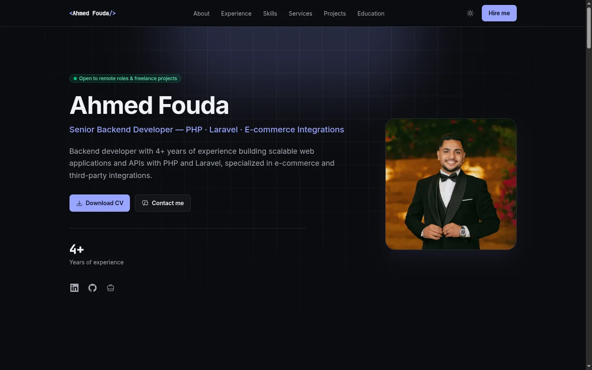
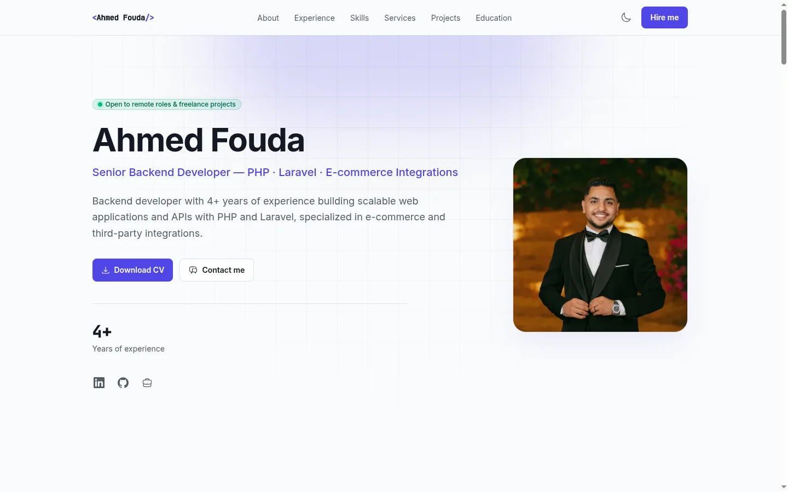
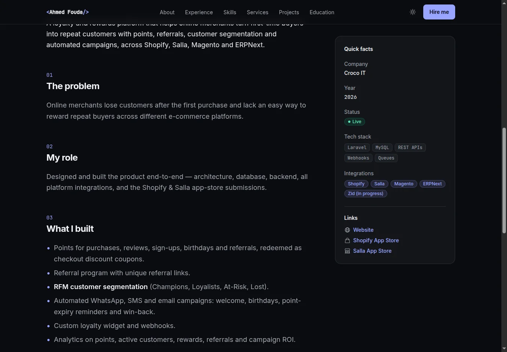
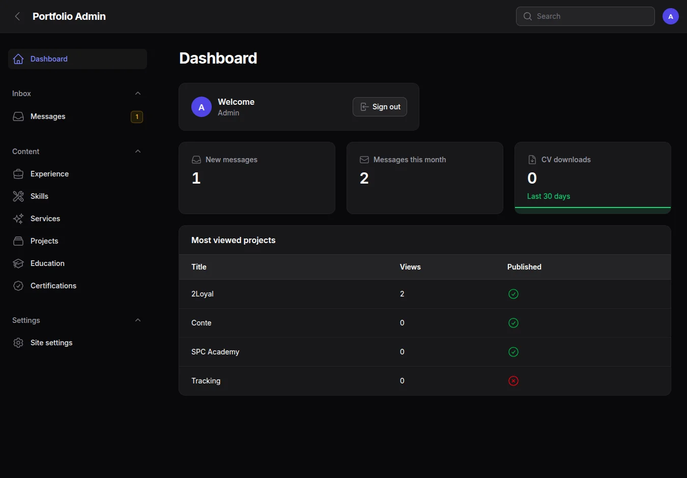

# Ahmed Fouda — Portfolio

[](https://github.com/ahmedfouda10/FoudaPortfolio/actions/workflows/ci.yml)


The source code of my personal portfolio: a server-rendered Laravel 13 site with a
Filament 5 dashboard where **every piece of public content is editable** — profile,
experience, skills, services, case studies, education and the CV.

**Live site:** `TODO: add the URL once deployed`

| Home (dark) | Home (light) |
|---|---|
|  |  |
| **Case study** | **Dashboard** |
|  |  |

## Features

**Public site**
- One-page portfolio (hero, about, experience timeline, skills, services, projects,
  education & certifications, contact) plus a case-study page per project.
- Dark mode by default with a remembered light/dark toggle and no flash of the wrong theme.
- Client-side project filter by integration, accessible mobile menu, keyboard-friendly
  image lightbox, CSS-only scroll animations that respect `prefers-reduced-motion`.
- Livewire contact form with inline validation, a pre-selected inquiry type from the
  "Hire me" buttons, and layered spam protection.
- Tracked CV download (the PDF lives on a private disk) and per-visitor daily project views.
- SEO: per-page meta, canonical URLs, Open Graph/Twitter cards, `sitemap.xml`,
  environment-aware `robots.txt`, and schema.org JSON-LD (`Person`, `WebSite`,
  `CreativeWork`, `BreadcrumbList`).
- Responsive WebP images (`srcset` + intrinsic sizes), self-hosted fonts, WCAG AA contrast.

**Dashboard (Filament 5)**
- Single admin account from `.env`, enforced app-based MFA, `noindex` + `no-store` everywhere.
- Drag-and-drop ordering and visibility toggles on every list, a tabbed project editor
  (overview, case study, media with image editor, links, SEO) and a site-settings page.
- Contact-message inbox with a new-messages badge, read/replied/archive actions and
  one-click "Reply by email".
- Widgets: new messages, messages this month, CV downloads (30-day chart), most viewed projects.

## Tech stack

| Layer | Choice |
|---|---|
| Language | PHP 8.4, `declare(strict_types=1)` in every file |
| Framework | Laravel 13 |
| Dashboard | Filament 5 |
| Front end | Blade, Livewire 4, Alpine.js (bundled with Livewire), Tailwind CSS v4, Vite |
| Database | MySQL 8.4 |
| Quality | Pest 5 (with architecture tests), Larastan level 8, Laravel Pint |
| Local env | Laravel Sail (app, MySQL, Mailpit) |
| CI | GitHub Actions: Pint → Larastan → Pest on MySQL with coverage |

## Architecture

```
HTTP request
  └─ thin invokable controller ──► Query class (cached) ──► readonly DTO ──► Blade components
                                └► Action class (writes) ──► queued Mail / Notification / Job
```

- **Actions** (`app/Actions`) hold the business logic for writes and are final,
  invokable classes: `StoreContactMessageAction`, `RecordProjectViewAction`,
  `RecordCvDownloadAction`.
- **Queries + DTOs** (`app/Queries`, `app/Data`) load each page in a fixed number of
  eager-loaded queries and return typed, read-only objects. `Model::shouldBeStrict()`
  makes any N+1 or lazy load fail in development and tests.
- **Enums** (`app/Enums`) model fixed sets (project status, link type, inquiry type,
  message status, employment type) and are cast on the models; labels come from
  `lang/en/enums.php`.
- **Reusable scopes** via Laravel's `#[Scope]` attribute: `published()`, `featured()`,
  `featuredFirst()`, `visible()`, `ordered()`, `unread()`.
- **Validation** lives in a Livewire Form object (the Livewire counterpart of a Form Request).
- **Translations**: every UI string (site, dashboard, emails) goes through `__()` and lives
  in `lang/en/*.php`, ready for a second language.

### Caching strategy

The public pages are served from the cache (`App\Support\PublicContentCache`):

- Keys are **versioned** (`public-content:v{n}:home`). Flushing bumps the version, which
  invalidates every public entry at once on any cache store, without tags.
- A model observer flushes on every create/update/delete of public content, ignoring
  view-counter updates. Filament's drag-and-drop reordering (a single bulk `UPDATE`
  that fires no model events) flushes through the table's `afterReordering` hook.
- Laravel 13 refuses to unserialize objects from the cache by default; only the
  read-only content classes are allow-listed in `config/cache.php`.

### Queues

Everything slow runs on the queue (`QUEUE_CONNECTION=database`): the owner's
new-message notification (with `Reply-To` set to the sender), the optional auto-reply,
and the generation of responsive WebP variants for every uploaded image.

### Spam protection and privacy

- Contact form: a honeypot (bots get a fake success), a minimum time to submit, and a
  rate limit of 3 messages per 10 minutes per visitor.
- IP addresses are never stored: only an HMAC-SHA256 keyed with the app key.
- The auto-reply contains nothing the visitor typed, so the form cannot be used to send
  arbitrary content to third parties.
- No third-party requests: fonts are downloaded at build time, avatars and the favicon
  are generated SVGs, and there are no trackers.

## Project structure

```
app/
├── Actions/            # write use cases (final, invokable)
├── Data/               # readonly DTOs for pages and the contact form
├── Enums/
├── Filament/           # resources, settings page, widgets
├── Http/Controllers/   # thin, invokable
├── Jobs/               # GenerateImageVariants
├── Livewire/           # ContactForm + Forms/ContactMessageForm
├── Models/Concerns/    # sort order, visibility, file cleanup, image variants
├── Observers/          # public cache invalidation
├── Queries/            # cached read models
└── Support/            # cache, SEO, images, IP hashing, bot detection
tests/
├── Arch/               # architecture rules
├── Feature/            # HTTP, Livewire and Filament tests
└── Unit/
```

## Local setup (Laravel Sail)

Requirements: Docker, plus PHP 8.4 and Composer on the host for the first install.

```bash
git clone https://github.com/ahmedfouda10/FoudaPortfolio.git portfolio
cd portfolio

composer install
cp .env.example .env            # then set ADMIN_EMAIL and ADMIN_PASSWORD

./vendor/bin/sail up -d
./vendor/bin/sail artisan key:generate
./vendor/bin/sail artisan migrate --seed
./vendor/bin/sail artisan storage:link
./vendor/bin/sail npm install
./vendor/bin/sail npm run dev
./vendor/bin/sail artisan queue:work   # contact-form emails and image variants are queued
```

| Service | URL |
|---|---|
| Website | http://localhost |
| Dashboard | http://localhost/admin |
| Mailpit | http://localhost:8025 |

Ports already in use? Override `APP_PORT`, `FORWARD_DB_PORT`, `FORWARD_MAILPIT_PORT` and
`FORWARD_MAILPIT_DASHBOARD_PORT` in `.env`. Set `ADMIN_REQUIRE_MFA=false` locally to skip
the authenticator-app setup.

## Tests and code quality

```bash
sail artisan test          # Pest
sail composer test:lint    # Pint (check only)
sail composer test:types   # Larastan, level 8
sail composer test         # all of the above
```

The suite covers the public pages, the cache and its invalidation, the contact form
(validation, honeypot, timing, rate limit, queued emails), view and CV tracking, SEO
output, image variants, and every dashboard resource. Architecture tests enforce strict
types, no debug helpers, `env()` only in config, final Actions/Livewire/Filament classes,
queued emails and controllers that never touch the query builder.

Tests run on in-memory SQLite locally; CI runs the same suite on **MySQL 8.4** with coverage.

## Deployment

The site runs on a plain Linux server (Nginx, PHP-FPM 8.4, MySQL, Supervisor, cron).
See **[DEPLOYMENT.md](DEPLOYMENT.md)** for server requirements, first-time setup and the
example Nginx/Supervisor configs. Updates are a single command:

```bash
./deploy.sh
```

## License

Released under the [MIT License](LICENSE).
